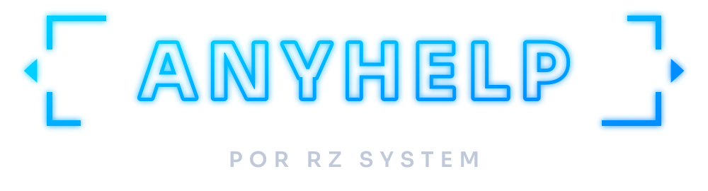

<p align="center">
  
</p>

# AnyHelp

Acesso remoto da **RZ System**: o cliente baixa, informa **ID + senha** e recebe
suporte em segundos. Construído sobre o [RustDesk](https://github.com/rustdesk/rustdesk)
(open source, AGPL-3.0), com a identidade visual do Manual da Marca RZ System e
servidor próprio na VPS da empresa.

## Como o projeto é organizado

Este repositório **não** guarda uma cópia do RustDesk. Ele guarda só a camada
AnyHelp: marca, configurações, servidor e site. No build, o GitHub baixa o
RustDesk na versão fixada, aplica a camada e compila. Assim, atualizar o RustDesk
é trocar um número em `anyhelp.json`.

```
AnyHelp/
├── anyhelp.json               ← nome, versão do RustDesk, links, recursos ligados/desligados
├── branding/
│   ├── source/                ← ícone e logos em SVG (fonte da verdade)
│   ├── generated/             ← PNG/ICO gerados a partir dos SVGs
│   ├── fonts/                 ← Sora (títulos) e Inter (textos), licença OFL
│   └── tools/                 ← build_svgs.py e make_icons.py
├── scripts/
│   ├── apply_branding.py      ← transforma o RustDesk no AnyHelp
│   └── upstream_versions.py   ← lê as versões de Flutter/Rust usadas pelo RustDesk
├── _github/workflows/        ← vira .github/workflows ao rodar scripts/preparar-repositorio.ps1
│   ├── build-windows.yml      ← compila o AnyHelp.exe (Windows x64)
│   └── check-branding.yml     ← checagem rápida a cada push
├── server/                    ← servidor da VPS (Docker): hbbs + hbbr
├── site/                      ← página de download e de privacidade
└── docs/                      ← guias passo a passo
```

## Arquitetura

```
 Cliente (AnyHelp.exe)                VPS RZ System                 Técnico (AnyHelp.exe)
 ┌──────────────────┐   registra ID   ┌──────────────┐  registra ID  ┌──────────────────┐
 │ ID 482 913 607   │ ──────────────► │ hbbs  :21116 │ ◄──────────── │ digita o ID +    │
 │ senha k7m2xq     │                 │ (IDs)        │               │ senha            │
 └────────┬─────────┘                 ├──────────────┤               └────────┬─────────┘
          │                           │ hbbr  :21117 │                        │
          │                           │ (relay)      │                        │
          │                           └──────────────┘                        │
          └────────── conexão direta P2P criptografada (ou via relay) ────────┘
```

- **Multiusuário:** cada máquina tem um ID único; qualquer número de técnicos
  acessa qualquer número de máquinas ao mesmo tempo, cada sessão é independente.
- **Sem contas:** login e catálogo de endereços desligados. O acesso é por ID +
  senha (temporária ou permanente) ou pelo clique em "Aceitar".
- **Servidor travado:** o IP e a chave da VPS vão gravados no app e a tela de
  servidor fica escondida. O servidor só aceita clientes com a chave AnyHelp.

## Começando (ordem recomendada)

| # | Passo | Guia |
|---|---|---|
| 1 | Subir o servidor na VPS e anotar IP + chave | [docs/SERVIDOR-VPS.md](docs/SERVIDOR-VPS.md) |
| 2 | Criar o repositório no GitHub, cadastrar IP + chave e gerar o `.exe` | [docs/PUBLICAR-VERSAO.md](docs/PUBLICAR-VERSAO.md) |
| 3 | Publicar `site/` no site da RZ System (trocar `SUA-ORG` no topo do `index.html`) | — |
| 4 | Quando sair versão nova do RustDesk | [docs/ATUALIZAR-RUSTDESK.md](docs/ATUALIZAR-RUSTDESK.md) |

## Identidade visual

Segue o Manual da Marca RZ System v1.0:

| Elemento | Aplicação no AnyHelp |
|---|---|
| Paleta | Azul Neon `#00CFFF` (ID, destaques), Azul Elétrico `#008DFF` (botões, cor primária), Azul Marinho `#061B3D` (painéis), Preto Tecnológico `#020B18` (fundo) |
| Gradiente principal | `#00CFFF → #008DFF` no ícone, logo, faixa do "Sobre" e botões do site |
| Tipografia | **Sora** nos títulos, **Inter** nos textos (embutidas no app) |
| Símbolo | "AH" em contorno neon dentro da moldura de colchetes com setas laterais, no mesmo sistema do símbolo RZ |
| Tema | Escuro por padrão (o usuário pode mudar para claro em Configurações) |

Para alterar o ícone/logo: edite `branding/tools/build_svgs.py` (ou os SVGs em
`branding/source/`), rode `build_svgs.py` e depois `make_icons.py`.

## Licença

O AnyHelp é uma obra derivada do RustDesk e é distribuído sob a **GNU AGPL-3.0**
(veja [LICENSE](LICENSE)). Na prática:

- O uso comercial é permitido.
- O **código-fonte do AnyHelp precisa estar disponível** para quem recebe o app.
  O repositório público no GitHub e o link na tela "Sobre" do app cumprem isso.
- Os créditos ao RustDesk ficam preservados na tela "Sobre".
- O nome e o logo "RustDesk" não são usados na marca do produto.

As fontes Sora e Inter são distribuídas sob a SIL Open Font License
(`branding/fonts/OFL-*.txt`).
